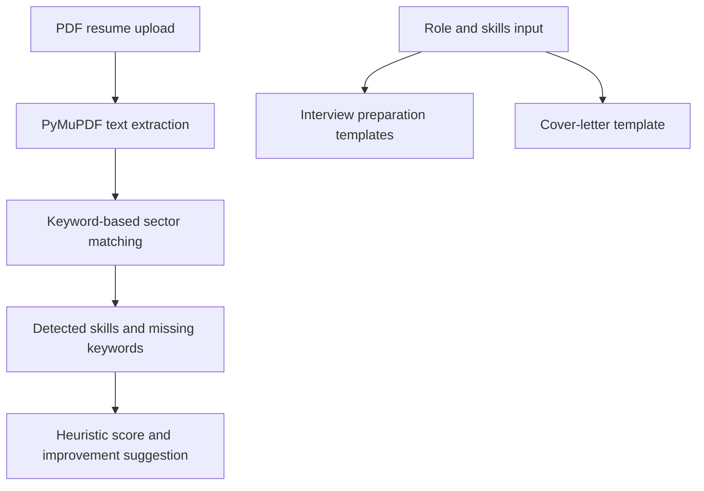

# LaunchPad

**Resume review and career-preparation prototype**

LaunchPad pairs an Android client built with Kotlin with a Python backend. This repository currently contains the backend prototype only.

## Current capabilities

- **PDF text extraction:** accepts PDF resume uploads and extracts text with PyMuPDF.
- **Sector estimation:** compares extracted text against keyword lists for Developer, Marketing and Finance roles.
- **Resume feedback:** returns matched skills, missing keywords, a heuristic score and a short improvement suggestion.
- **Interview preparation:** returns templated interview sentences and question-and-answer content based on a supplied role and skills string.
- **Cover-letter drafting:** returns a basic template populated with the requested role and skills.
- **Optional Supabase client setup:** initialises a client when `SUPABASE_URL` and `SUPABASE_KEY` are configured. The current route handlers do not yet persist or retrieve data through Supabase.

> **Important scope note:** the resume score is a simple keyword-based heuristic, not a validated ATS score. The interview and cover-letter endpoints currently return templates; they do not call a generative AI model.

## Backend stack

- Python
- FastAPI
- PyMuPDF
- Pydantic
- Supabase Python client (initialisation only in the current backend)
- Uvicorn

## Run locally

1. Create and activate a virtual environment.
2. Install dependencies:

   ```bash
   pip install -r requirements.txt
   ```

3. Optionally configure Supabase environment variables if you want the client to initialise:

   ```bash
   export SUPABASE_URL="your_supabase_url"
   export SUPABASE_KEY="your_supabase_key"
   ```

   On Windows PowerShell, use:

   ```powershell
   $env:SUPABASE_URL="your_supabase_url"
   $env:SUPABASE_KEY="your_supabase_key"
   ```

4. Start the backend:

   ```bash
   python main.py
   ```

The app uses port `10000` by default, or the value of the `PORT` environment variable. With the server running, open `http://localhost:10000/docs` for the interactive FastAPI documentation.

## Backend flow



## API routes

| Method | Route | Input | Purpose |
|---|---|---|---|
| `GET` | `/` | — | Basic service status |
| `POST` | `/upload_resume` | PDF file field named `file` | Extract resume text and return keyword-based feedback |
| `POST` | `/generate_prep_guide` | JSON with `skills` and `role` | Return interview-preparation templates |
| `POST` | `/generate_cover_letter` | JSON with `skills` and `role` | Return a basic cover-letter draft |

Example request for interview preparation:

```json
{
  "skills": "Python, FastAPI, SQL",
  "role": "Backend Developer"
}
```

## Current implementation notes

- Sector selection is based on the number of matching keywords in the extracted resume text.
- The current score starts at 40 points and increases by 10 for each detected sector keyword, capped at 98.
- The top four missing sector keywords are returned as a priority roadmap.
- Supabase is initialised when credentials are present, but the visible endpoints do not currently use it.
- The Kotlin Android client is not included in this repository at present.

## Next development priorities

1. Add file-size limits, safe temporary-file handling and stronger upload validation.
2. Improve PDF extraction and handle scanned/image-based resumes explicitly.
3. Replace the arbitrary score formula with explainable, role-specific evaluation criteria.
4. Add tests for PDF parsing, sector matching, scoring and API validation.
5. Integrate a real generation model for interview preparation and cover letters, with clear user controls.
6. Connect Supabase to actual user, document and result persistence if that remains part of the product design.
7. Add the Android client source or link to its repository so the full application can be reviewed.

---

LaunchPad is an evolving project exploring practical, transparent tools for resume review and career preparation.
