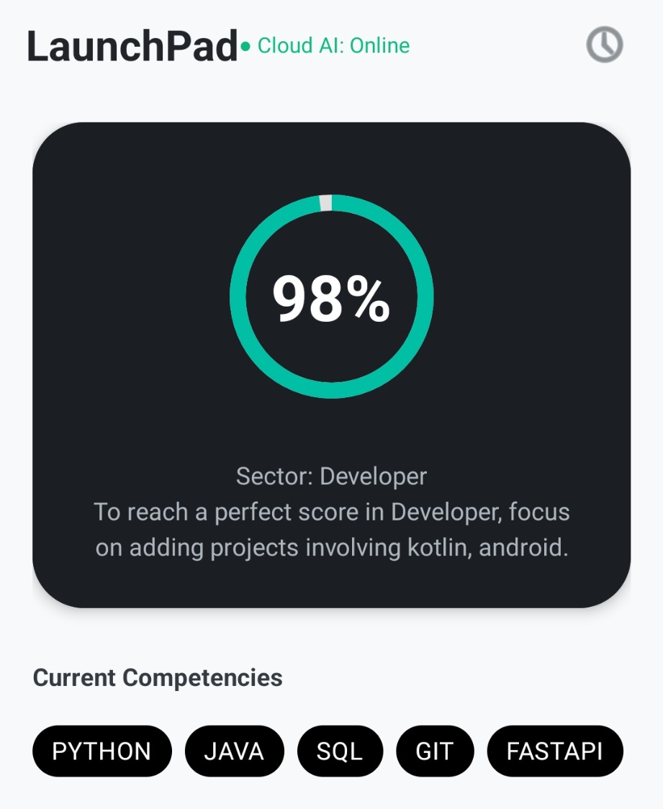
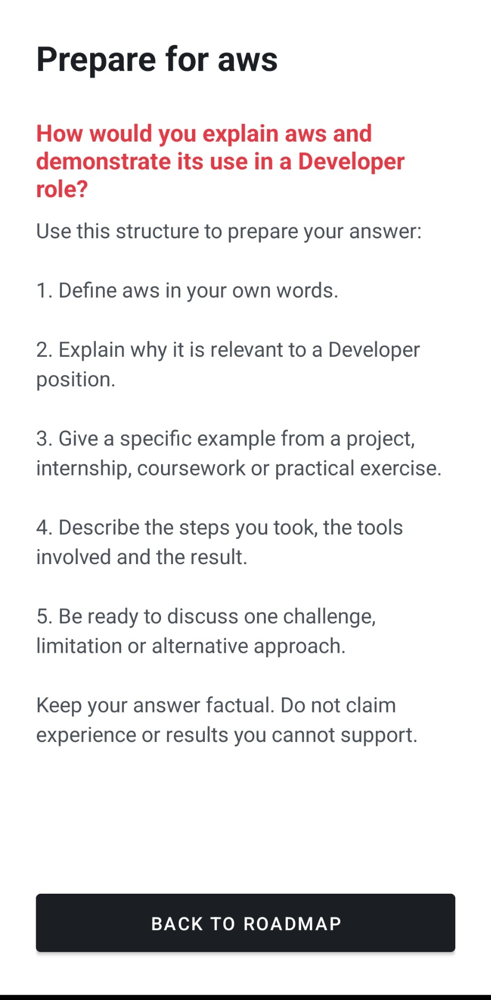

# LaunchPad

**Turn a resume into clearer skills, stronger feedback and relevant career directions.**

LaunchPad is a career-support prototype built around an Android app and a Python API. It helps a job seeker see which skills their resume demonstrates, the text evidence behind each match, and which ESCO occupation profiles share those skills.

The [Android client (Kotlin/XML)](https://github.com/notreallyflash) is maintained separately; this repository contains the backend, ESCO database scripts and tests.

## How it works

```text
PDF resume
    |
    v
FastAPI upload endpoint
    |
    v
PyMuPDF text extraction ── low-text page (< 80 characters) ──> English Tesseract OCR
    |
    v
Text normalization + technical-token-aware phrase generation
    |
    v
Supabase RPC: resolve_esco_skill_labels
    |
    v
Evidence-backed skill matches + ambiguity review
    |
    v
Supabase RPC: rank_esco_occupations
    |
    v
Resume feedback + confirmed ESCO skills + ranked occupations (JSON)
```

## Product preview

The Android client presents a resume overview and a guided interview-preparation flow.

<p align="center">
  
  &nbsp;&nbsp;
  
</p>

<p align="center">
  <sub>Android UI previews · Resume overview and interview preparation</sub>
</p>

## Core capabilities

### Resume analysis and OCR fallback

Extracts selectable text with PyMuPDF and falls back to English Tesseract OCR only on low-text pages (fewer than 80 selectable characters). Uploads are limited to 15 MB and 15 pages.

The backend preserves the existing sector estimate, keyword feedback, heuristic score, strengths and roadmap while running ESCO analysis as a separate stage.

### Evidence-based ESCO skill recognition

The recognizer checks resume phrases against ESCO preferred, alternative and hidden labels. Every confirmed match carries its canonical ESCO skill URI, matched phrase and evidence snippet, allowing the client to show where a skill was found instead of presenting an unexplained label.

Key implementation choices:

- **Technical-token preservation:** `C++`, `C#`, `.NET`, `Node.js` and `CI/CD` remain intact during tokenization.
- **Longest exact phrase wins:** when multiple labels start at the same position, the longer phrase takes priority.
- **Canonical URI deduplication:** repeated mentions and aliases credit one skill concept while retaining evidence occurrences.
- **Ambiguity is surfaced:** a phrase that maps to multiple ESCO concepts is returned for review and does not become a confirmed skill.
- **Hidden labels require review:** hidden-label-only matches are kept separate; a stronger preferred- or alternative-label match can confirm the same URI.
- **Bounded candidate phrases:** phrases are generated and sent to Supabase in batches instead of loading the full ESCO label catalog into API memory.

### Occupation ranking

The ranking function compares confirmed skill URIs with ESCO occupation-skill relationships. It returns matched and total essential/optional skills, essential coverage and weighted skill coverage.

The current first pass searches ISCO major groups 1–5 and applies initial filters: at least two matched essential skills, 10% essential coverage and 8% weighted skill coverage.

### Interview and cover-letter preparation

- `POST /generate_prep_guide` returns structured interview prompts and sample answers based on a supplied role and skills.
- `POST /generate_cover_letter` returns a basic cover-letter template populated with the supplied role and skills.

## Backend stack

| Area | Technology |
|---|---|
| API | Python 3.13, FastAPI, Uvicorn |
| PDF extraction | PyMuPDF |
| OCR | Tesseract OCR, English language data, pytesseract and Pillow |
| Skill recognition | Python phrase matcher backed by ESCO labels in PostgreSQL |
| Data access | Supabase Python client and PostgreSQL RPC functions |
| Container | Docker |
| Mobile client | Kotlin and XML layouts |

## Repository structure

```text
.
├── main.py
├── services/
│   └── skill_recognition.py
├── sql/
│   ├── 01_schema.sql
│   ├── 02_resolve_esco_skill_labels.sql
│   └── 03_rank_esco_occupations.sql
├── tests/
│   ├── test_skill_recognition.py
│   └── test_resume_esco_integration.py
├── examples/
├── docs/
│   └── screenshots/
├── Dockerfile
├── .dockerignore
└── requirements.txt
```

## Getting started

### Requirements

- Python 3.13 recommended.
- A Supabase project.
- ESCO reference data loaded into the application tables.
- Tesseract OCR with English language data for local processing of scanned PDFs. The Docker image installs these system dependencies automatically.

### 1. Clone the repository and create a virtual environment

```bash
git clone https://github.com/notreallyflash/LaunchPad.git
cd LaunchPad
python -m venv .venv
```

Activate the environment:

**Windows PowerShell**

```powershell
.\.venv\Scripts\Activate.ps1
```

**macOS / Linux**

```bash
source .venv/bin/activate
```

### 2. Install Python dependencies

```bash
python -m pip install --upgrade pip
python -m pip install -r requirements.txt
```

For local OCR, install the Tesseract executable and English language data for your operating system, then make sure `tesseract` is available on `PATH`. If it is installed in a custom location, set `TESSERACT_CMD` to the executable path.

### 3. Configure environment variables

Create a `.env` file in the repository root:

```env
SUPABASE_URL=https://YOUR_PROJECT_REF.supabase.co
SUPABASE_ANON_KEY=YOUR_SUPABASE_ANON_KEY
# Optional when Tesseract is not on PATH:
# TESSERACT_CMD=/path/to/tesseract
# Optional:
# LOG_LEVEL=INFO
```

Keep real credentials private. Never commit `.env` or paste secret values into issues, logs or screenshots. The repository `.gitignore` excludes local environment files.

`SUPABASE_ANON_KEY` is used for the public, read-only ESCO reference catalog. It does not authenticate callers to `/upload_resume`. The current schema grants read access to the ESCO reference tables for `anon` and `authenticated`; if Row-Level Security (RLS) is enabled, matching read policies must also be configured.

### 4. Create the application tables

Run [`sql/01_schema.sql`](sql/01_schema.sql) in the Supabase SQL Editor to create the four tables and supporting indexes used by the recognition and ranking queries:

| Table | Purpose |
|---|---|
| `esco_skills` | Canonical skill concepts, preferred labels, skill type and reuse level |
| `esco_skill_labels` | Preferred, alternative and hidden labels mapped to canonical skill URIs |
| `esco_occupations` | Occupation concepts and ISCO group metadata |
| `esco_occupation_skill_relations` | Occupation-to-skill links classified as essential or optional |

### 5. Download and import ESCO data

Get the source classification from the [official ESCO download page](https://esco.ec.europa.eu/en/use-esco/download). Choose **ESCO v1.2.1**, **classification**, **English (`en`)** and **CSV**. The [dataset structure guide](https://esco.ec.europa.eu/en/structure-esco-downloadable-datasets) explains the source files and URI relationships.

The official package is a source dataset, not a drop-in export of the four LaunchPad tables. Prepare four normalized CSVs with the target columns defined in `sql/01_schema.sql`, then import them into Supabase using the Table Editor's CSV import:

1. **`esco_skills`** — map individual skill/competence concepts from `skills_en`: concept URI, preferred term, skill type and reuse level. Import skill concepts, not skill-group rows.
2. **`esco_skill_labels`** — expand preferred, alternative and hidden labels into separate rows. Set `label_type` to `preferred`, `alternative` or `hidden`; store a lowercase, whitespace-normalized `normalized_label` while preserving technical punctuation. Keep duplicate normalized labels for different URIs so ambiguity can be surfaced.
3. **`esco_occupations`** — map occupation concepts from `occupations_en`: occupation URI, preferred term and ISCO-08 code. Derive `isco_major_group` from the first digit of the ISCO-08 code.
4. **`esco_occupation_skill_relations`** — map links from `occupationSkillRelations_en`, joining concepts by ESCO URI and translating each relationship to `essential` or `optional` in `relation_type`.

Import the canonical skill and occupation tables before their label and relationship tables so foreign keys can be checked. The schema creates the database structure; it does not download or transform the ESCO CSV package. Record the source version alongside the imported data so catalog refreshes can be reproduced.

### 6. Create the RPC functions

After the tables are populated, run these scripts in the Supabase SQL Editor:

1. [`sql/02_resolve_esco_skill_labels.sql`](sql/02_resolve_esco_skill_labels.sql) creates `resolve_esco_skill_labels`, the exact-label lookup used by the recognizer.
2. [`sql/03_rank_esco_occupations.sql`](sql/03_rank_esco_occupations.sql) creates `rank_esco_occupations`, the occupation coverage query.

The lookup RPC reads `esco_skill_labels` and `esco_skills`. The ranking RPC reads `esco_occupation_skill_relations`, `esco_occupations` and `esco_skills`.

### 7. Start the API

```bash
uvicorn main:app --reload --host 0.0.0.0 --port 10000
```

Open the interactive API documentation at [http://localhost:10000/docs](http://localhost:10000/docs). The app uses the `PORT` environment variable when the hosting platform provides it.

## Docker

The Dockerfile installs Tesseract and English language data alongside the Python dependencies, then runs the API as a non-root user.

Build the image:

```bash
docker build -t launchpad-backend .
```

Run it locally with a local `.env` file:

```bash
docker run --rm \
  --env-file .env \
  -e PORT=10000 \
  -p 10000:10000 \
  launchpad-backend
```

The `.dockerignore` file excludes local secrets, virtual environments, caches, tests, examples and SQL scripts from the image build context. Apply the SQL files separately in Supabase as described above.

## API reference

### Health check

Use `GET /` to verify that the FastAPI process is responding:

```bash
curl http://localhost:10000/
```

Response:

```json
{"status":"online","message":"LaunchPad AI Engine is Live"}
```

This is a process-level response; it does not independently verify Supabase or ESCO RPC availability.

| Method | Route | Input | Purpose |
|---|---|---|---|
| `GET` | `/` | — | Basic service health response |
| `POST` | `/upload_resume` | Multipart PDF field named `file` | PDF extraction, resume feedback, ESCO skill recognition and occupation ranking |
| `POST` | `/generate_prep_guide` | JSON with `skills` and `role` | Interview-preparation prompts and sample answers |
| `POST` | `/generate_cover_letter` | JSON with `skills` and `role` | Basic cover-letter template |

### Upload a resume

```bash
curl -X POST \
  -F "file=@resume.pdf;type=application/pdf" \
  http://localhost:10000/upload_resume
```

A successful response preserves the original resume-analysis fields and adds `esco_analysis`. This **contract example** uses a consistent developer profile; the sample URI and metric values are illustrative.

```json
{
  "ats_score": 60,
  "market_insight": "Developer",
  "core_strengths": ["python", "sql"],
  "priority_roadmap": ["java", "kotlin"],
  "improvement_tip": "To improve your profile for Developer, focus on java, kotlin.",
  "esco_analysis": {
    "status": "success",
    "occupation_ranking_status": "success",
    "confirmed_skills": [
      {
        "skill_uri": "http://data.europa.eu/esco/skill/EXAMPLE-PYTHON-URI",
        "preferred_label": "Python (computer programming)",
        "label_type": "preferred",
        "skill_type": "skill/competence",
        "reuse_level": "cross-sector",
        "matched_phrases": ["python"],
        "evidence_snippets": ["...built backend services using Python and SQL..."],
        "occurrence_count": 1,
        "match_status": "exact_unique_label"
      }
    ],
    "ambiguous_matches": [],
    "review_matches": [],
    "confirmed_skill_uris": [
      "http://data.europa.eu/esco/skill/EXAMPLE-PYTHON-URI"
    ],
    "occupation_matches": [
      {
        "occupation_uri": "http://data.europa.eu/esco/occupation/EXAMPLE-SOFTWARE-DEVELOPER-URI",
        "occupation_label": "Software developer",
        "isco_group_code": "2512",
        "isco_major_group": "2",
        "matched_essential": 2,
        "total_essential": 14,
        "essential_coverage": 14.3,
        "matched_optional": 1,
        "total_optional": 9,
        "weighted_skill_coverage": 12.4
      }
    ],
    "token_count": 400,
    "candidate_phrase_count": 1500,
    "catalog_row_count": 40,
    "truncated": false
  }
}
```

### Interview-preparation request

```json
{
  "skills": "Python, FastAPI, SQL",
  "role": "Backend Developer"
}
```

### Cover-letter request

```json
{
  "skills": "Python, FastAPI, SQL",
  "role": "Backend Developer"
}
```

## Security and operational notes

The current endpoint has baseline input and resource controls: PDF extension validation, a 15 MB upload limit, a 15-page limit, temporary-file cleanup, a 20-second timeout per OCR page, and a Docker container that runs as a non-root user. These are useful safeguards, but the upload route is not yet ready to be exposed as an unrestricted public service.

**Authentication and rate limiting are not implemented.** `/upload_resume` does not currently verify Supabase JWTs or enforce per-user request limits. Before public release, add JWT verification, per-user and per-IP rate limits, upload/concurrency quotas, a request-wide OCR budget, and CPU/memory monitoring.

### Supabase keys and Row-Level Security

`SUPABASE_ANON_KEY` is the public/anonymous API key. The current backend uses it for the **public, read-only ESCO reference catalog**. It does not identify or authorize a LaunchPad user. The schema grants `SELECT` on ESCO reference tables to `anon` and `authenticated`; if RLS is enabled, matching read policies must also be configured or lookups may return no rows.

For future user-specific tables, choose an explicit access model:

- **User-scoped access:** forward the signed-in user's Supabase JWT in the `Authorization: Bearer <token>` header and make database requests under that user's identity so RLS policies can enforce ownership.
- **Trusted server-side access:** use a privileged server-side key only after explicit authentication, authorization and ownership checks. A service-role key bypasses normal RLS protections; keep it out of the Android app, public repositories, client-side builds and logs.

Keep the ESCO reference catalog read-only for application users, apply least-privilege grants, and review table policies and RPC execution permissions when the schema changes.

### OCR resource budget

OCR can consume significant CPU and memory on scanned pages. The current 20-second timeout is **per OCR page**, not per request. With the 15-page upload limit, the theoretical OCR-only upper bound is 300 seconds (15 × 20 seconds). A request-wide cap—such as a 45-second cumulative budget or a maximum of 3–5 OCR pages per upload—is a required pre-production improvement and is **not yet enforced**. A mobile client or hosting proxy may close a connection before a worst-case request completes.

## Tests

Run the test suite from the repository root:

```bash
python -m pytest -v
```

The tests cover deterministic skill matching and ambiguity handling, plus upload integration paths for successful recognition, ranking failure, recognition failure and an unavailable catalog. The integration tests mock PDF extraction and the Supabase-backed catalog; they complement but do not replace a live Supabase, OCR and deployment smoke test.

## Methodology and scope

LaunchPad is a prototype for transparent resume feedback and career exploration. The original resume score is a keyword heuristic (40 points plus 10 per matched sector keyword, capped at 98), not a validated ATS measure. Sector classification uses predefined keyword lists. ESCO matching establishes that a label and evidence phrase appear in a resume; it does not measure proficiency, depth or years of experience. Occupation coverage measures overlap with an ESCO skill profile, not employability or hiring probability. Interview-preparation and cover-letter endpoints currently return templates rather than generative-AI output. OCR is configured for English, and its quality depends on scan quality and layout.

## Android client

The mobile app is built with Kotlin and XML layouts. The current Android project is maintained separately; see the [GitHub profile](https://github.com/notreallyflash) for project updates. The backend API contract above is the integration reference for the client.

---

LaunchPad is an evolving project exploring practical, evidence-backed tools for resume understanding and career direction.
